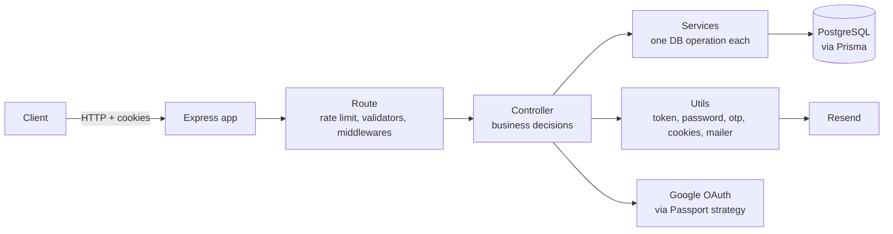
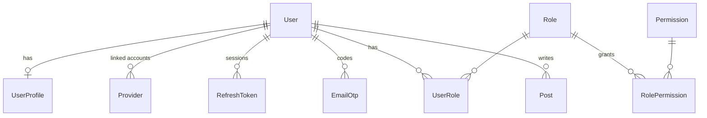
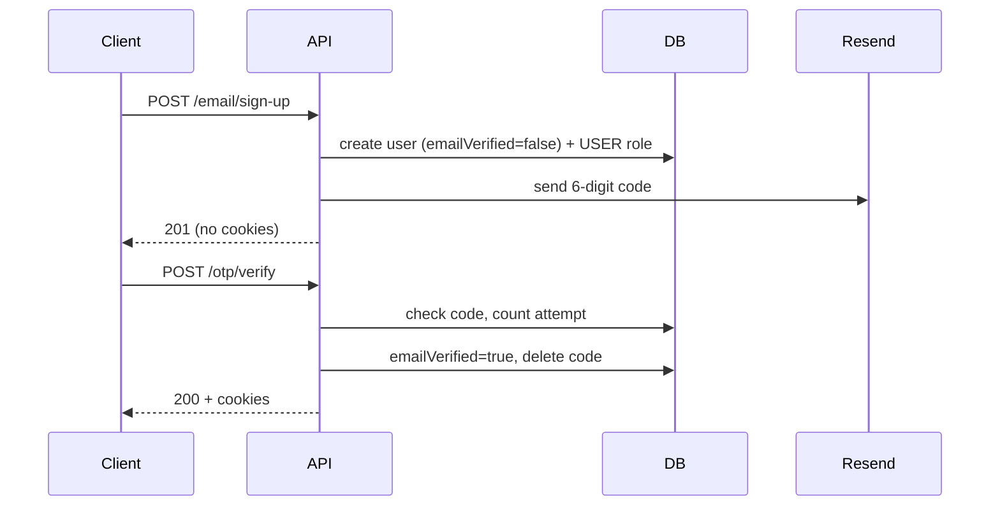

# Architecture

How the system is built, how a request flows through it, and why it is built that way.

## Overview



The code is split so that each layer has one job:

| Layer | Job | Must not |
|---|---|---|
| **Route** | Declares the path, method, rate limit and the ordered pipeline | Contain logic |
| **Validator** | Checks and normalizes `body`, `params` or `query` with Zod | Touch the database |
| **Middleware** | Cross-cutting checks: authentication, permissions, ownership | Send success responses |
| **Controller** | Makes the decisions: what happens, which status to return | Run queries directly |
| **Service** | Performs exactly one database operation | Hash, sign, read env, or decide anything |
| **Utils** | Stateless helpers: tokens, hashing, cookies, mail | Hold request state |

Every controller, validator, middleware, route and service is **one class per file**.

## Request pipeline

`BaseRoute` builds the same ordered pipeline for every route:

```
rate limit → validators → middlewares → controller
```

1. **Rate limit.** An in-memory limiter keyed by IP, or by IP and email when the body has one. Over the limit returns 429 with `Retry-After`.
2. **Validators.** Zod parses the input and replaces `req.body`, `req.params` or `req.query` with the parsed result, so the controller receives trimmed, lowercased, defaulted and stripped data.
3. **Middlewares.** Run in array order. A typical protected route is `Authenticate`, then a permission check.
4. **Controller.** Runs inside a try/catch in `BaseController.execute`. An unexpected error is logged with the request ID and answered with a 500.

Validators run before middlewares, so a malformed request is rejected before any database work.

All responses go through `Base.respond`, which produces the same envelope (`status`, `message`, `timestamp`, `requestId`, `data`).

## Directory map

```
src/
├── server.ts                 process entry point
├── app/
│   ├── app.ts                builds the Express instance (used by server and tests)
│   ├── routes/               one class per endpoint, mounted in routes/index.ts
│   ├── controllers/          one class per endpoint
│   ├── validators/           Zod schemas wrapped as middlewares
│   └── middlewares/          authenticate, permission/role checks, ownership, error handler
├── core/
│   ├── base/                 Base, BaseRoute, BaseMiddleware, controllers, rate limiter
│   ├── strategie/            Passport strategies (Google)
│   └── utils/                token, password, otp, cookies, mailer, env, logger, constants
├── database/
│   ├── system/               Prisma client and BaseService
│   └── services/             auth/, authz/, post/, user/
└── types/                    shared types and the Express Request augmentation
prisma/
├── schema.prisma             generator and datasource
├── schemas/                  models split by domain: auth, authz, post
├── migrations/
└── seed.ts                   roles, permissions, admin
tests/                        endpoint tests, mirrors src/app layout
```

Each folder has an `index.ts` that builds a registry (`Controllers`, `Validators`, `Middlewares`, `Services`), so routes import `Controllers.Post.List` instead of file paths.

## Data model



- **`User.password` is nullable.** A null password means a Google-only account.
- **`User.emailVerified` drives the pending state.** There is no separate "pending" status. A pending user is a row with `emailVerified = false`.
- **`User.status` is a boolean.** `false` means disabled.
- **`EmailOtp.purpose`** (`VERIFY_EMAIL` or `PASSWORD_RESET`) stops a signup code from being used to reset a password.
- **`RefreshToken.tokenHash`** and **`EmailOtp.codeHash`** store hashes, so a database leak doesn't hand out live sessions or codes.
- Deleting a user cascades to everything that belongs to them.

## Authentication

### Tokens

| Token | Lifetime | Where | Stored server-side |
|---|---|---|---|
| Access (JWT) | 15 min | `access_token` cookie (`/api`) or Bearer header | No |
| Refresh (JWT) | 7 days | `refresh_token` cookie (`/api/auth`) | SHA-256 hash only |

The refresh cookie is only sent to `/api/auth`, which limits how often it travels.

### Sign-up with email



### Google sign-in

The redirect controller creates a random `state`, stores it in a signed, `lax` cookie and sends the user to Google. The callback middleware compares the query `state` with the cookie in constant time, and the cookie is single use. The strategy only normalizes Google's profile. The controller decides what to do with it:

1. Google account already linked: sign in.
2. Email not registered: create a verified user with the `USER` role.
3. Email registered: link Google. If that account was unverified, mark it verified **and remove its password**, so whoever pre-registered the email can't keep access.

### Refresh rotation

Each refresh deletes the old token row and inserts the new one in a single transaction. If the old row is already gone, the swap fails and the request is rejected, so two simultaneous refreshes can't both succeed. A token that is validly signed but not stored means a rotated or revoked token is being replayed, so the controller revokes **every** session for that user.

## Authorization

Roles bundle permissions named `resource:action`. Routes check permissions, not role names, so adding a role never means editing routes.

- **`Authenticate`** verifies the access token, then **reloads the user and their roles and permissions from the database** and attaches `req.currentUser` and `req.access`.
- **`RequirePermission(...)`** requires all listed permissions. **`RequireRole(...)`** requires any listed role. Both read `req.access` and need no query.
- **Ownership** is handled by a middleware per resource (`PostWriteAccess`): the owner needs the `:own` permission, anyone else needs `:any`. It also attaches the loaded post to the request so the controller doesn't query again.
- `ADMIN` has no special code path. It can do everything because the seed grants it every permission.

`401` means "we don't know who you are". `403` means "we know, and you can't do this".

## Key decisions

| Decision | Why | Cost |
|---|---|---|
| Services do one data operation and nothing else | Logic lives in one layer, services stay trivially testable and reusable | More files, and controllers carry the orchestration |
| `BaseService.call()` returns `null` on any error | Controllers handle one